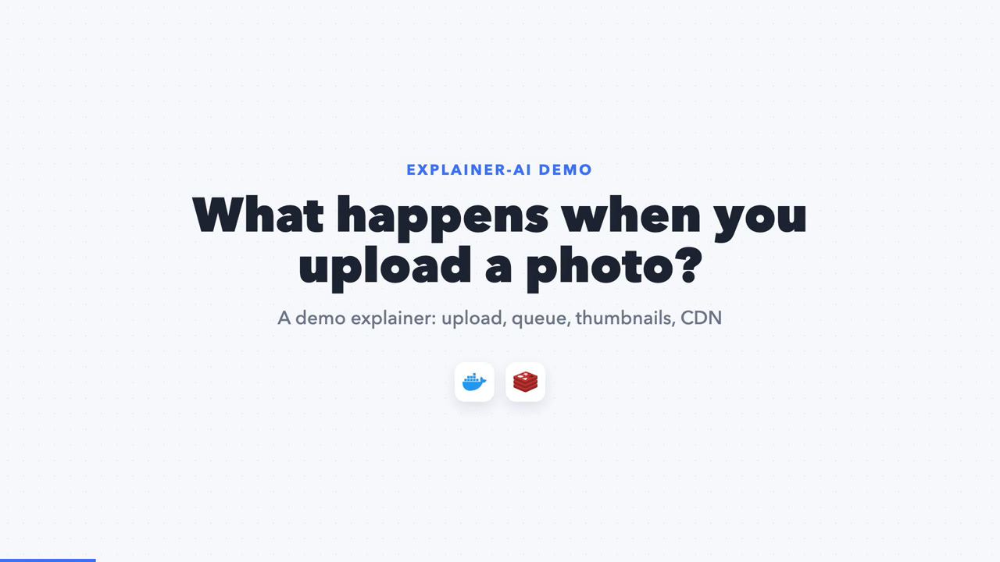
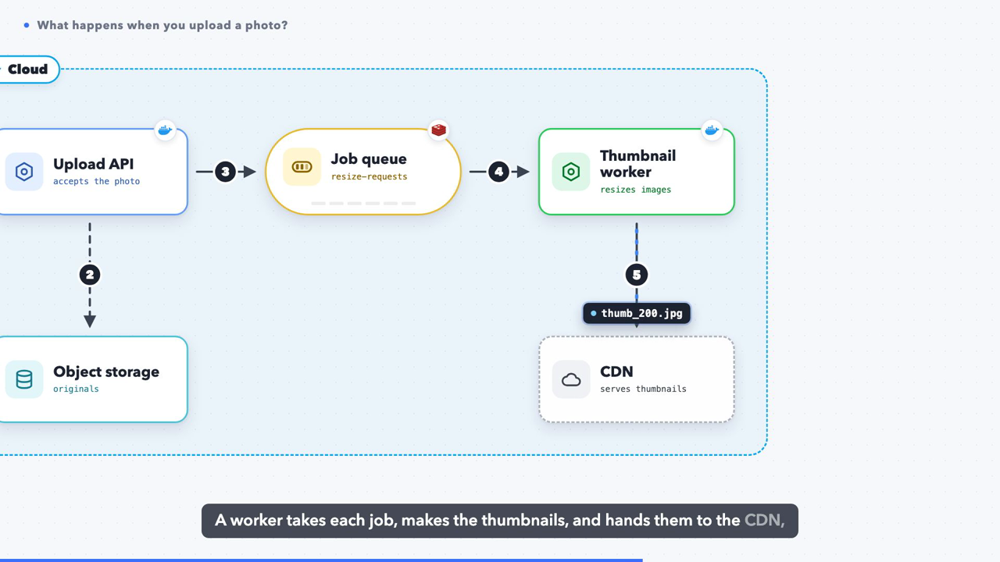
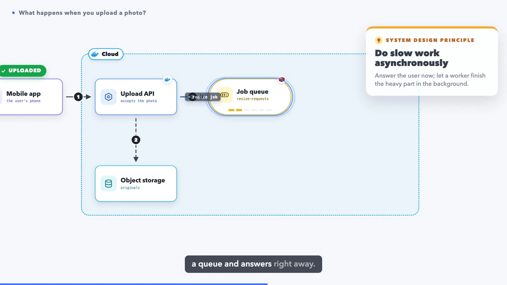
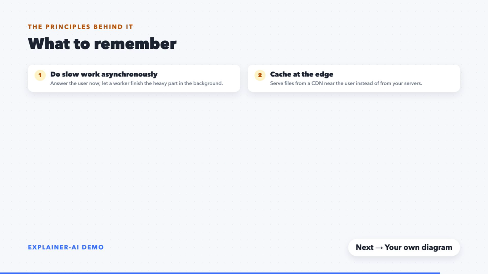
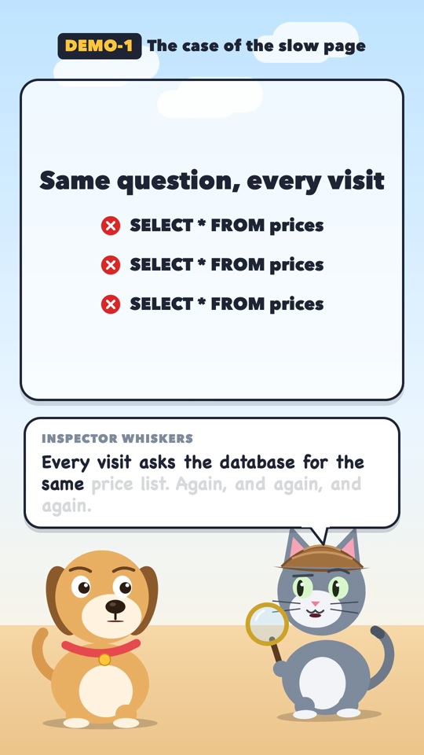

# explainer-ai

**Turn a JSON storyboard into a narrated, animated system-design video, rendered entirely on your machine.**

You describe a diagram (services, queues, databases, arrows) and what the narrator says. explainer-ai
generates the voice-over, times every animation to the exact word that is spoken, and renders an MP4:
boxes appear when they are named, arrows draw themselves, messages travel along them, the camera moves to
the part being explained, and "system design principle" cards pop up at the moment they apply.

The style is inspired by the diagram explainers made popular by channels like ByteByteGo. No cloud services,
no API keys: the voice is [Kokoro](https://huggingface.co/hexgrad/Kokoro-82M) running locally and the video
is rendered with [Remotion](https://www.remotion.dev).

<p align="center">
  
  
  
  
</p>

## Two formats

| | **Explainer** (16:9) | **Reel** (9:16) |
|---|---|---|
| What it is | One diagram that builds up while a narrator walks through a system | Two cartoon characters (a dog asks, a cat explains) over an "evidence board" |
| Good for | Architecture walkthroughs, onboarding, "what happens when…" | Short updates: a bug story, a ticket, a release note |
| You write | `storyboard.json` | `script.json` + `boards.tsx` (one small React component per scene) |
| Example | [`examples/explainer-demo`](examples/explainer-demo) | [`examples/reel-demo`](examples/reel-demo) |

<p align="center"></p>

## How it works

```
storyboard.json ──► packages/tts (Kokoro, local) ──► voice/vo.wav + timeline.json (every word's start frame)
                                                                   │
                         packages/renderer (Remotion) ◄────────────┘ ──► video.mp4
```

1. **Narration.** Each beat's `say` text is spoken by Kokoro. The script records when every word starts.
2. **Timing.** Every on-screen action is anchored to a word (`"at": "queue"`), so the visuals land exactly on
   the narration, and stay in sync when you rewrite a sentence.
3. **Rendering.** Remotion draws the diagram as React components and renders each frame with headless Chrome.

## Quick start

Requirements: macOS or Linux, Node.js 20+, Python 3.12 with [uv](https://docs.astral.sh/uv/),
`espeak-ng` (`brew install espeak-ng`), and `ffmpeg` is handy for checking output.

```bash
npm install          # Nx, at the workspace root
npm run setup        # renderer deps, Python venv for Kokoro, icons
npx nx run renderer:explainer --dir=examples/explainer-demo   # → examples/explainer-demo/explainer-demo.mp4
npx nx run renderer:reel --dir=examples/reel-demo             # → examples/reel-demo/reel-demo.mp4
```

The first narration downloads the Kokoro model (about 330 MB) and the first render downloads a headless Chrome.
A one-minute explainer takes about a minute and a half to render on an M-series Mac.

| Command | What it does |
|---|---|
| `npx nx run renderer:explainer --dir=<folder>` | Narrate and render an explainer |
| `npx nx run renderer:reel --dir=<folder>` | Voice and render a reel |
| `SKIP_VOICES=1 ./render-explainer.sh <folder>` | Re-render visuals only (when you changed `do` actions, not `say`) |
| `npm run studio` | Remotion Studio: scrub through the last rendered explainer or reel live |
| `python3 scripts/check-storyboard.py <folder>` | Catch mistakes before rendering: unknown ids, unspoken anchors, overlapping cards, arrows through cards |
| `scripts/stills.sh <folder> <frame>…` | Render a few frames to `<folder>/.stills/` to look at (explainers can be previewed in parallel) |
| `npm run typecheck` | Type-check the renderer (cached by Nx) |
| `npx nx run renderer:icons` | Re-download icons into `packages/renderer/public/icons/` |

## Writing an explainer

An explainer is one folder with a `storyboard.json`. Start by copying `examples/explainer-demo`.

```jsonc
{
  "title": "What happens when you upload a photo?",
  "narrator": { "voice": "am_michael", "speed": 1.0 },
  "diagram": {
    "nodes": [ { "id": "api", "kind": "service", "label": "Upload API", "tone": "blue", "x": 700, "y": 500, "tech": ["docker"] } ],
    "edges": [ { "id": "enqueue", "from": "api", "to": "queue", "step": 3 } ],
    "groups": [ { "id": "cloud", "label": "Cloud", "icon": "docker", "color": "#0EA5E9", "members": ["api", "queue"] } ]
  },
  "beats": [
    { "say": "It drops a job on a queue and answers right away.",
      "do": [ { "draw": "enqueue", "at": "drops" },
              { "packet": "enqueue", "label": "resize job", "count": 3, "at": "job" },
              { "principle": { "name": "Do slow work asynchronously", "text": "Answer now; finish in the background." }, "at": "answers" } ] }
  ]
}
```

**Diagram**
- `nodes`: `kind` is `client`, `service`, `db`, `queue`, `render` or `cloud`. `tone` is a colour
  (`purple`, `blue`, `teal`, `yellow`, `gray`, `orange`, `green`). `x`/`y` is the centre on a large canvas.
  `icon` replaces the glyph with an SVG from `packages/renderer/public/icons/`, and `tech` adds small logo badges.
- `edges`: `step` shows a numbered badge, `dashed` is for reads and writes, and `bend` curves the arrow.
- `groups`: labelled boundaries such as a cloud, a cluster or a region, drawn around their `members`.

**Actions** (inside `do`, each optionally anchored with `"at": "<spoken word>"`, or `"word#2"` for the second occurrence)

| Action | Effect |
|---|---|
| `title: true` | Title card, with the logos used in the diagram |
| `overview: true` | Shows the whole map for this beat, then clears it to build up step by step |
| `focus: [ids] \| "all"` | Moves the camera to fit those nodes |
| `show: [ids]`, `group: [ids]` | Pops nodes or boundaries in |
| `draw: edgeId` | Draws an arrow; its step badge pops |
| `packet: edgeId, label, dur, count` | A message chip travels along the arrow; the arrow flows; the target pulses; queues fill and drain |
| `spot: [ids] \| null` | Dims everything else |
| `chip: nodeId, text, tone` | A status pill on a node (`amber` spins, `green` ticks, `red` crosses) |
| `note: nodeId, text` | A callout under the node for the rest of the beat |
| `principle: {name, text}` | A "system design principle" card |
| `recap: [lines], recapAt: [words]` | A recap list that lights up line by line |
| `outro: {next}` | Closing card with every principle in the episode, plus what comes next |

**Narration tips**
- Spell things the way they should sound: `"A P I"`, `"two oh two"`, `"Signal R"`. Then map them back for the
  captions with `"captionFix": { "A P I": "API" }`.
- Kokoro voices: `am_michael` and `am_puck` (American), `bm_george` (British), `af_heart` and `af_bella`. The first
  letter of the voice sets the accent.
- If you change any `say`, re-run the narration (don't set `SKIP_VOICES`), or the anchors drift.

## Writing a reel

A reel folder holds `script.json` (cast, voices and lines, each with a `scene`) and `boards.tsx`, which exports
`BOARDS: Record<scene, React.FC<{ f: number }>>`. Boards import shared building blocks (`Heading`, `Check`,
`Cross`, `pop`, `fade`…) from `@studio/ui`. Optional script fields: `"style": "3d"` for 3D characters, or
`"style": "office"` for a 3D meeting room whose wall shows `screen` (up to three lines).

## Keep your own work out of Git: `exports/`

Put real explainers and reels, their voices and rendered videos under `exports/` (for example
`exports/explainers/<name>/`). The folder is git-ignored, and the scripts accept any folder:

```bash
./render-explainer.sh exports/explainers/my-system
```

Keep old versions next to them in `archive/vN/`. Only `examples/` holds content meant to be shared.
Generated videos, audio, timing files and preview folders are ignored too. Your existing exports stay
on your machine; they are not included in a clone. Ignoring files is not encryption or access control:
never force-add private work, and check `git diff --cached` before committing.

## From Jira or Miro to a video

Use [CLAUDE.md](CLAUDE.md) as the coding-agent guide for turning authorized Jira ticket text and Miro
board content into a sourced, informative storyboard. It covers fact-checking, narration structure,
diagram mapping, word anchors and visual review. There is no built-in Jira or Miro integration.
Keep source exports, screenshots and notes alongside your project under `exports/`.
Public examples must use fictional content without internal links, customer data or private architecture.

## Project layout

```
explainer-ai/
├── packages/
│   ├── renderer/        Remotion app: src/explainer/ (diagram engine), src/Reel.tsx + characters, src/ui.tsx
│   └── tts/             Kokoro narration: make_narration.py (explainers, word timings), make_voices.py (reels)
├── examples/            Shareable demos: explainer-demo/, reel-demo/
├── exports/             Your private work (git-ignored)
├── scripts/fetch-icons.sh
├── render-explainer.sh  render-reel.sh
└── nx.json  package.json
```

## Licences, read before you publish videos

- **Remotion** is free for individuals and for companies with up to 3 employees. Larger companies need a
  [Remotion company licence](https://www.remotion.dev/license).
- **Kokoro** is Apache-2.0, so commercial use is fine.
- **Icons are downloaded, not bundled.** Logos come from [Iconify](https://iconify.design) sets; check each
  brand's guidelines. Azure service icons come from Microsoft's architecture icon pack, under Microsoft's terms
  (included in the download).
